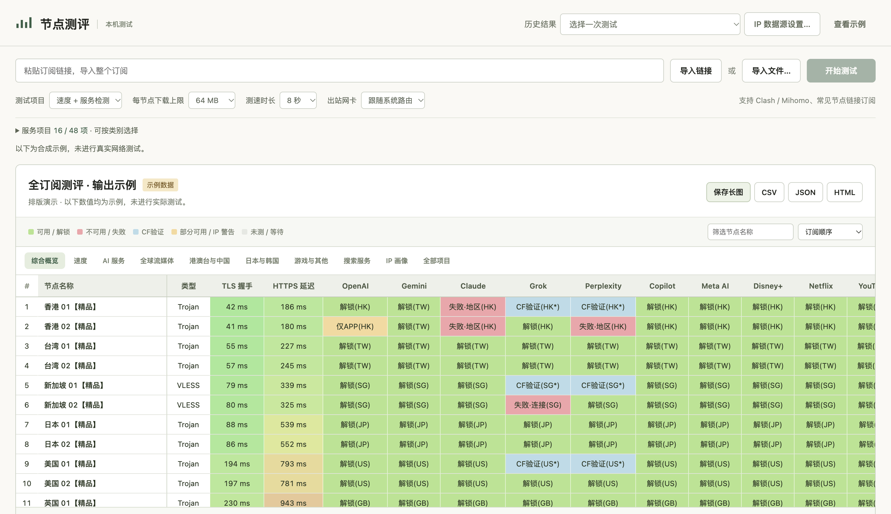

# 节点测评 · Node Test

导入订阅，批量测试节点速度、服务可用性和 IP 质量，以彩色表格展示结果。支持 macOS 和 Windows，可导出 PNG 长图、CSV、JSON 和 HTML。

[下载应用](https://github.com/WWangZQ/node-test/releases/latest) · [检测说明](docs/DETECTION.md) · [源码构建](docs/BUILD.md)

## 安装

| 系统 | 下载文件 | 启动方式 |
|---|---|---|
| Apple Silicon Mac | macos-arm64.dmg | 双击打开，将节点测评拖入 Applications |
| Intel Mac | macos-x86_64.dmg | 双击打开，将节点测评拖入 Applications |
| Windows 10 / 11，64 位 | windows-x64-Setup.exe | 双击安装，通过桌面或开始菜单启动 |

Windows 便携版另附 Portable.zip，可解压后直接运行。

首次打开遇到系统拦截时：Mac 在系统设置 → 隐私与安全性中选择仍要打开；Windows 在提示窗口中选择更多信息 → 仍要运行。

## 更新

应用启动后自动检查新版。点击顶部的检查更新，再选择下载并重启，即可完成升级。测试记录与 API 设置继续保留。

1.3.x 用户先安装一次 1.4.0，之后可在应用内更新。

## 使用

1. 粘贴订阅链接，或导入本地订阅文件。
2. 选择测速、服务检测或两者，点击开始测试。应用按顺序测试整个订阅。
3. 按分类查看结果，点击节点查看详细依据。
4. 保存长图，或导出 CSV、JSON、HTML。历史结果可从顶部菜单查看。

支持 Clash / Mihomo YAML、常见节点链接及 Base64 订阅。文件使用 UTF-8 编码，大小上限为 5 MB。测试中可随时停止，已完成的结果会保留。

测速依次尝试 Cloudflare、OVH、Vultr SG，表格记录实际使用的延迟和下载源。

测速默认每节点下载上限为 64 MB。100 个节点的下载上限合计约 6.4 GB，服务检测和 IP 查询另计流量。只查服务可用性时，选择仅服务检测。

## 常用检测项目

| 分类 | 项目 |
|---|---|
| AI 服务 | OpenAI、Gemini、Claude、Grok、Perplexity、Copilot、Meta AI |
| 流媒体 | Disney+、Netflix、YouTube、Spotify、Apple TV+ 网页、TikTok |
| 游戏与其他 | Steam、Wikipedia |
| 搜索 | Google |

默认选择以上 16 项，展开服务项目可选择更多服务。Google 与 Gemini 分别检测，地区和出口信息分别记录。

## IP 画像

接入 IPPure、ProxyCheck、NCGY、ipapi.is、Scamalytics、AbuseIPDB 和 IPQualityScore。IPPure、ProxyCheck、NCGY 支持匿名查询；其余来源在 IP 数据源设置中填写个人 API 密钥。

- 网络类型：住宅、商用、机房等用途按多数显示，保留最保守证据，冲突标黄。
- 接入类型：ISP、Fixed ISP、Wireless 等单独列出来源数量。
- 代理识别：分别统计命中、阴性和待确认结果。
- 滥用记录：展示报告数量、报告人数和时间。
- 来源评分：保留各家的分数与等级。0 分以中性色显示，机房、代理等标签单独提示。

各来源的查询状态与详细依据可在节点详情中查看。

## 数据保存

订阅内容在内存中处理，退出应用后清除。历史报告保存在本机，包含节点名称、出口 IP、检测结果和依据。应用菜单可打开结果文件夹。

API 密钥在 Mac 存入钥匙串，在 Windows 使用系统加密存储。检测请求经节点访问目标服务，IP 查询向数据提供方发送待查 IP。

## 开源

项目采用 **AGPL-3.0-only**，上游组件保留各自许可证。来源和版权说明见 [THIRD_PARTY_NOTICES.md](THIRD_PARTY_NOTICES.md)。发布页同时提供完整源码、Go 依赖源码和 SHA256 校验文件。
